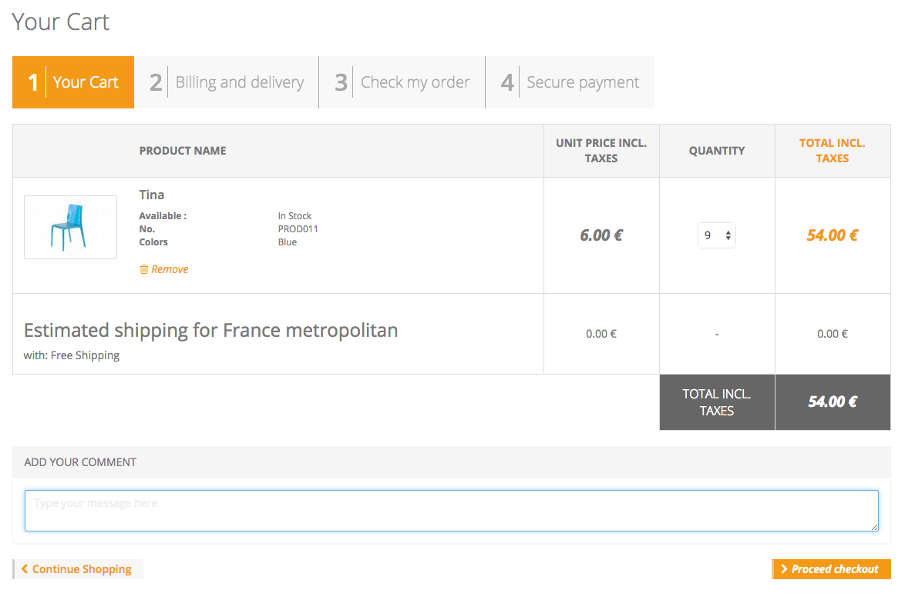

# OrderComment

This module allows your customers to write a comment for an order. Then you can find this comment in the order detail page of the backoffice.



## Installation

### Manually

* Copy the module into ```<thelia_root>/local/modules/``` directory and be sure that the name of the module is OrderComment.
* Activate it in your thelia administration panel

### Composer

Add it in your main thelia composer.json file

```
composer require thelia/order-comment-module:~2.0
```

## Usage

On the checkout delivery step, the customer comment is entered with the `AddOrderComment` live component. The comment is saved with the order and shown in the order detail page of the back office.
